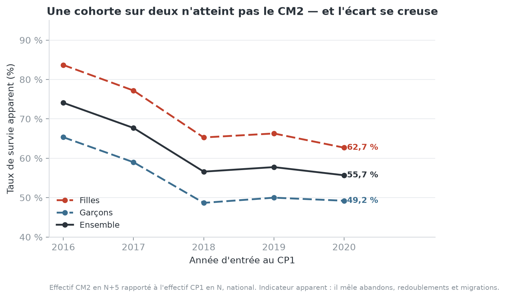
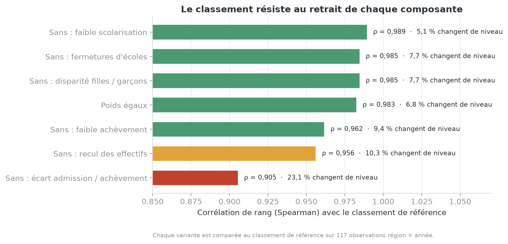
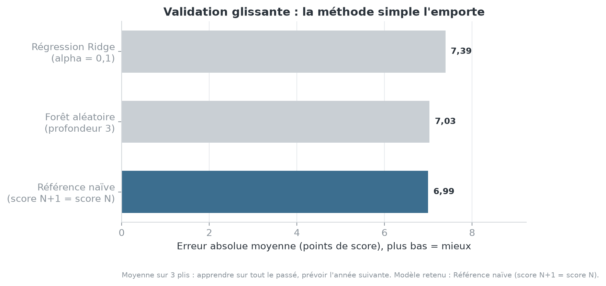
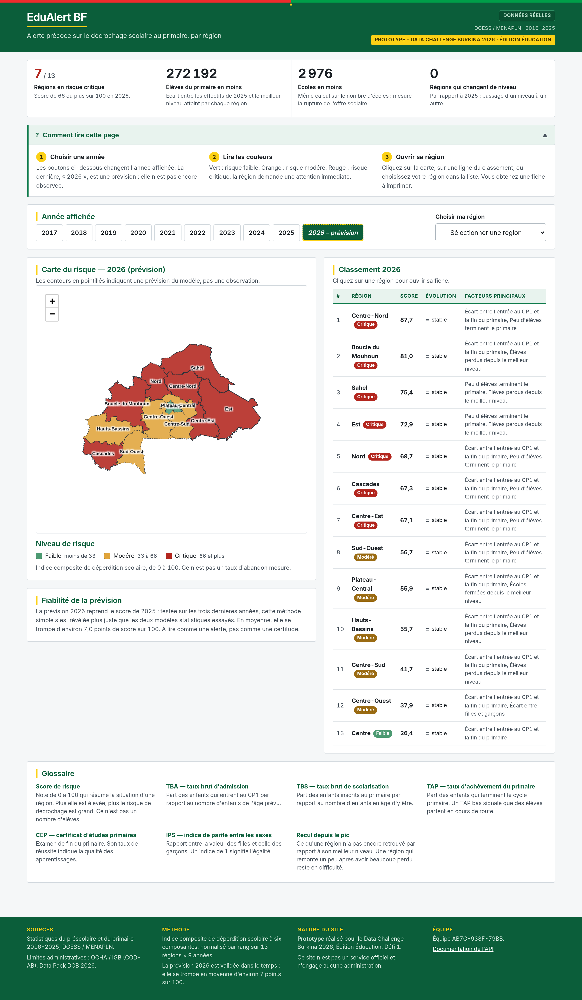
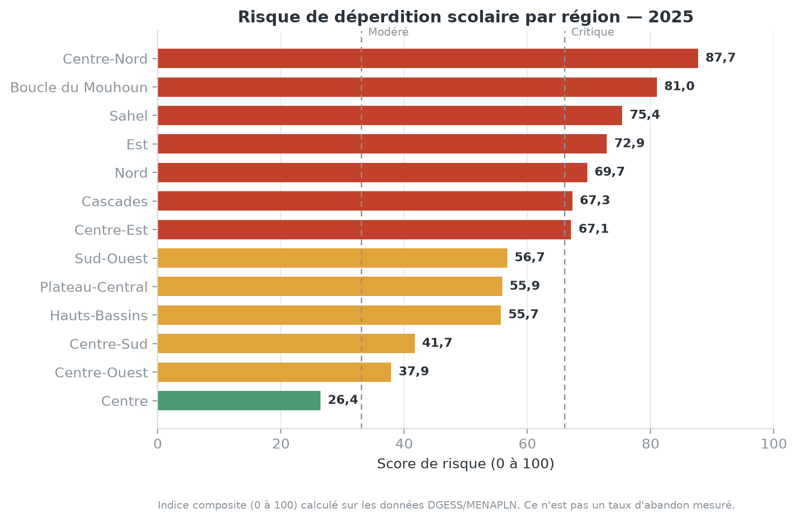
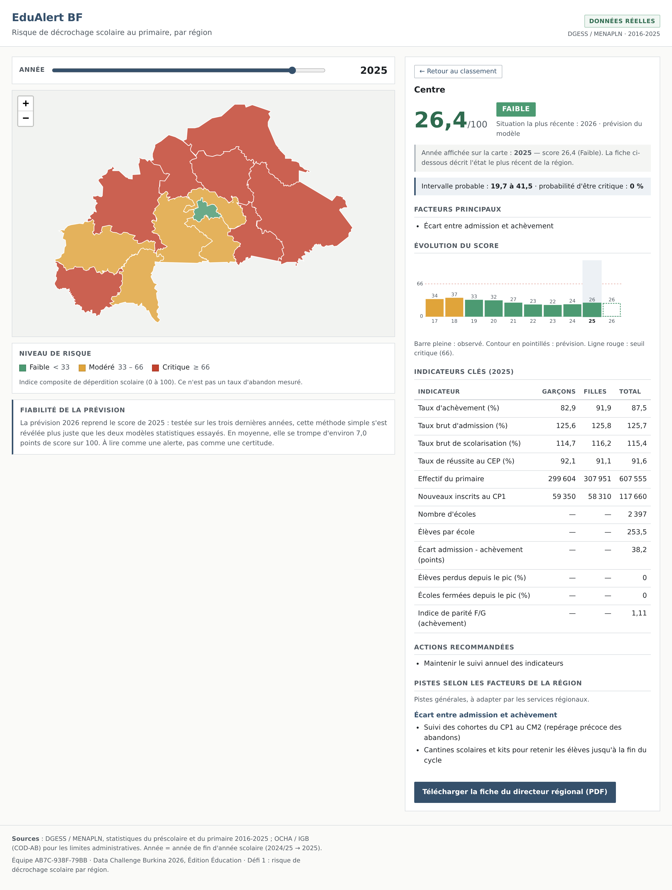
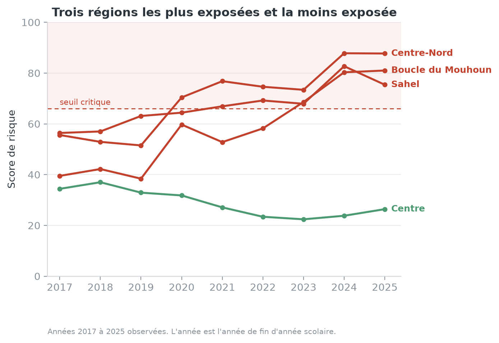
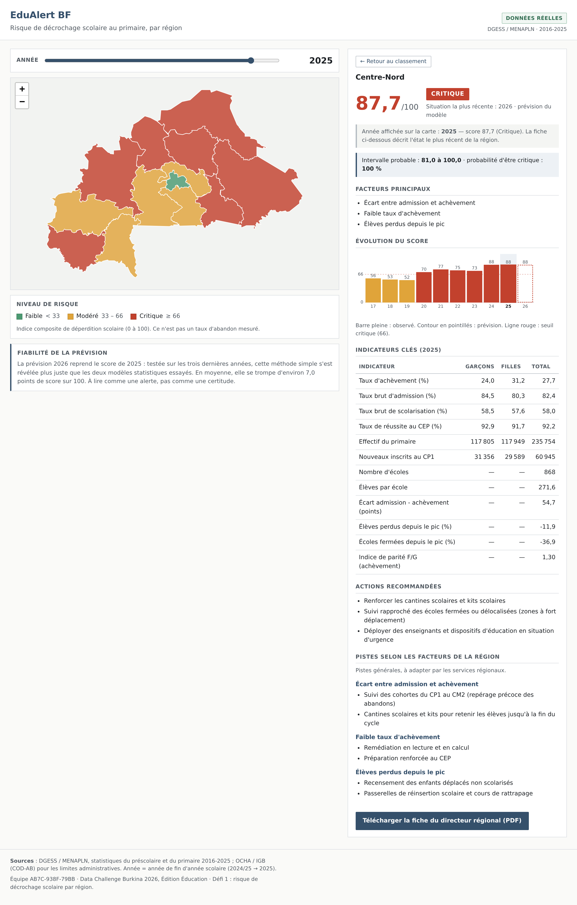
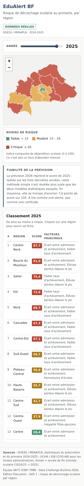

# 1. Le défi

**Défi choisi : Défi 1 – Cartographie et anticipation du risque de décrochage scolaire par région.**

**Notre question, avec nos mots :**
*Dans quelles régions du Burkina Faso les élèves du primaire risquent-ils le plus de quitter l'école l'an prochain,
pourquoi, et comment donner cette information à un directeur régional assez tôt pour qu'il agisse ?*

Aujourd'hui, le décrochage est constaté **après coup**, dans l'annuaire statistique de l'année suivante.
Entre 2016 et 2025, le système éducatif a connu une rupture brutale (fermetures d'écoles liées à l'insécurité,
déplacements de populations) qui a montré le coût de cette lecture tardive : quand l'annuaire paraît, les élèves sont déjà partis.

**Ce que propose EduAlert BF :**

1. un **score de risque de décrochage** par région et par année, de 0 à 100, classé en trois niveaux (Faible, Modéré, Critique) ;
2. une **prévision pour l'année scolaire suivante** ;
3. une **carte interactive** et une **fiche d'alerte d'une page** par région, pensée pour le directeur régional (DREPS).

**Pour qui :** le MENAPLN et la DGESS (pilotage national), les directions régionales et provinciales (DREPS, DPEPS) pour cibler
cantines, kits scolaires, enseignants et actions de sensibilisation.

**Périmètre retenu :** l'enseignement **primaire**, au niveau des **13 régions** du découpage de l'annuaire DGESS, de 2015/16 à 2024/25.
Notre note d'intention visait aussi le post-primaire, le secondaire et le niveau établissement ; les données publiques disponibles
(agrégées par région et par année) ne le permettent pas sans tomber dans l'approximation. Nous avons préféré un périmètre plus
étroit mais solide (voir section 6, limites).

# 2. Les données

## 2.1 Sources utilisées

| Donnée | Producteur | Publication | Année | Usage |
|---|---|---|---|---|
| Statistiques du préscolaire et du primaire 2016-2025 | DGESS / MENAPLN | Fichier fourni par le Data Challenge | 2025 | Effectifs, taux, écoles, CEP |
| Limites administratives (niveau régions) | OCHA / IGB – COD-AB | Data Pack DCB 2026 | 2026 | Contours de la carte |

Deux sources envisagées dans la note d'intention n'ont **pas** été retenues, et il faut
le dire explicitement plutôt que de laisser croire qu'elles alimentent le score :

| Source écartée | Pourquoi |
|---|---|
| Personnes déplacées internes (CONASUR / OCHA) | Publiée selon le découpage en 17 régions et à des dates qui ne coïncident pas avec l'année scolaire. La rattacher aux 13 régions aurait demandé une clé de répartition que nous n'avons pas pu vérifier. L'insécurité est donc captée **indirectement**, par les fermetures d'écoles et le recul des effectifs, qui sont mesurés dans le fichier DGESS lui-même |
| Population par région (INSD, RGPH 2019) | Nos indicateurs sont déjà des taux calculés par la DGESS sur ses propres dénominateurs. Introduire une seconde base de population aurait créé deux taux différents pour la même réalité |

Le score repose donc sur **une seule source statistique**, le fichier DGESS, plus les
contours administratifs pour l'affichage. C'est une limite assumée, et c'est aussi ce
qui rend chaque chiffre traçable jusqu'à sa cellule d'origine.

L'inventaire complet est déposé : `AB7C-938F-79BB_01-collecte_D1_architect_inventaire-sources_v1.csv`.

## 2.2 Contenu du fichier DGESS

Le fichier comporte 14 tableaux, tous **par région** (13 anciennes régions) et **par année scolaire** de 2015/16 à 2024/25 :
effectifs du préscolaire et du primaire par sexe, par statut (public/privé) et par milieu (urbain/rural) ; effectifs par niveau
(CP1 à CM2, au niveau national) ; nouveaux inscrits au CP1 ; taux brut d'admission (TBA), taux brut de scolarisation (TBS)
et taux d'achèvement (TAP) par sexe ; taux de réussite au CEP ; indices de parité ; nombre d'écoles par statut.

## 2.3 Limites des données

- **Pas de donnée individuelle ni infra-annuelle** : pas d'absentéisme, pas de notes trimestrielles, pas de suivi d'élève.
  Le « décrochage » est donc mesuré **indirectement**, à l'échelle d'une région (voir 4.1).
- **Pas de taux d'abandon publié par région** dans le fichier : nous le reconstruisons à partir des indicateurs disponibles.
- **Granularité régionale** : 13 régions × 10 années = 130 observations. C'est peu pour un modèle d'apprentissage automatique ;
  cela guide nos choix de méthode (section 4).
- **Rupture de 2022/23** : chute brutale des effectifs et du nombre d'écoles dans plusieurs régions. C'est à la fois le signal
  que nous voulons détecter et une difficulté pour la prévision (changement de régime).
- **Deux découpages administratifs** : les données DGESS suivent les 13 anciennes régions ; les cartes récentes suivent les
  17 nouvelles régions (voir 3.1).

# 3. La préparation

## 3.1 Réconcilier deux cartes du pays : 17 régions → 13 régions

**Le problème.** Les limites administratives du Data Pack (OCHA COD-AB, 2026) découpent le Burkina Faso en **17 nouvelles régions**
(Bankui, Djôrô, Goulmou, Guiriko, Kadiogo, Koulsé, Liptako, Nakambé, Nando, Nazinon, Oubri, Sirba, Soum, Sourou, Tannounyan,
Tapoa, Yaadga). Les statistiques DGESS 2016-2025 sont publiées selon les **13 anciennes régions**. Les deux découpages
ne se recoupent pas un à un : on ne peut pas poser directement les chiffres sur la carte.

**Notre solution.** Chaque polygone du fichier COD-AB conserve le nom et le code de son ancienne région
(`adm1_name_old`, `adm1_pcode_old`). Le script `pipeline/geo_regions.py` :

1. regroupe les 17 polygones par ancienne région ;
2. **fusionne** les géométries de chaque groupe (union géométrique) : par exemple *Bankui + Sourou → Boucle du Mouhoun*,
   *Goulmou + Sirba + Tapoa → Est*, *Liptako + Soum → Sahel* ;
3. **simplifie** les contours (tolérance d'environ 1 km) : le fichier passe d'environ **10 Mo à 59 Ko**, ce qui permet un
   affichage instantané dans le navigateur sans perte visible à l'échelle nationale ;
4. produit une **table de correspondance** 17 ↔ 13 (`correspondance_regions_17_13.csv`), réutilisable pour rattacher
   toute donnée publiée selon le nouveau découpage (déplacés, population récente).

**Contrôle :** 17 polygones en entrée, 13 régions en sortie, chaque nouvelle région rattachée à exactement une ancienne.

## 3.2 Une clé commune pour toutes les données

Pour que toutes les sources se croisent, chaque valeur est rangée selon la même clé :

| Clé | Règle |
|---|---|
| `region_code` | Nom de l'ancienne région en majuscules, sans accent ni espace (`BOUCLE-DU-MOUHOUN`) : une seule orthographe, quelle que soit la source |
| `annee` | **Année de fin d'année scolaire** : 2024/25 → 2025. Évite la confusion année scolaire / année civile |
| `sexe` | `G`, `F` ou `T` (total) |

Les indicateurs sont stockés au **format long** (une ligne = région × année × sexe × indicateur) : ajouter une nouvelle source
revient à ajouter des lignes, sans modifier la base ni l'application. Le schéma complet et le dictionnaire des variables sont
déposés : `AB7C-938F-79BB_03-transformation_D1_architect_schema-dictionnaire-donnees_v1.md`.

## 3.3 Nettoyage du fichier DGESS

Le script `pipeline/nettoyer_dgess.py` transforme le classeur en tables exploitables.
Il est **relançable sans aucune action manuelle** et écrit son propre journal,
`data/02_nettoyage/journal_nettoyage.md`, qui recense opération par opération ce qui a
été fait et pourquoi.

**Ce que le fichier impose, et notre réponse :**

| Difficulté rencontrée | Traitement |
|---|---|
| Plusieurs tableaux empilés dans un même onglet | Repérage des lignes de titre « Tableau … » et délimitation par la ligne de total ou la ligne vide suivante. Dans l'onglet PRESCOLAIRE, 8 titres ont été trouvés : seul le tableau régional est lu |
| Nom de région écrit uniquement sur la première ligne d'un bloc | Propagation vers le bas ; 28 cellules par onglet concerné |
| Lignes de total (NATIONAL, Burkina Faso, Total général) mêlées aux régions | 240 lignes mises de côté dans `dgess_totaux-nationaux.csv` : elles ne sont pas des régions, mais elles servent aux contrôles |
| Indices de parité stockés comme **formules Excel** | Les onglets Feuil10 à Feuil12 ne sont pas lus. Les IPS sont **recalculés** à l'étape 03 comme rapport taux F / taux G, à partir des taux eux-mêmes |
| Noms de régions écrits de trois façons différentes selon l'onglet | `BOUCLE DU MOUHOUN`, `HAUT-BASSINS` et `PLATEAU CENTRAL` ramenés au code officiel |
| Année noyée dans un en-tête contenant du texte étranger aux données | 37 cellules sur les 14 onglets. Seule l'année est extraite par expression régulière ; le texte n'est ni interprété, ni recopié dans un livrable |

**Deux règles que nous nous sommes interdites d'enfreindre :**

- **une cellule vide reste vide.** Aucune valeur manquante n'a été remplacée par zéro ni
  par une moyenne : un zéro inventé se propage ensuite dans un taux et dans un score.
  Le journal l'atteste : 0 valeur imputée ;
- **aucun arrondi à l'export du nettoyage.** Les taux sont écrits en pleine précision.
  Les IPS étant des rapports de taux, arrondir les taux à deux décimales déplacerait la
  quatrième décimale du rapport. L'arrondi n'est fait qu'à l'affichage.

**Vérification des totaux (règle d'or du challenge).** Les lignes nationales mises de
côté servent de témoin indépendant : la somme des 13 régions est comparée au total
publié par la DGESS pour chaque variable et chaque année.

> **218 contrôles exécutés, 0 hors tolérance.**

Sorties : `dgess_regional_long.csv` (3 120 lignes), `dgess_national_long.csv` (840 lignes)
et `dgess_totaux-nationaux.csv` (240 lignes), pour 10 variables régionales sur 2016-2025,
avec 13 régions distinctes dans chacun des 8 onglets régionaux.

## 3.4 Variables construites

Le fichier DGESS fournit des effectifs et des taux. Il ne fournit pas de mesure de
déperdition. L'étape 03 construit donc les variables qui manquent, à partir des seules
colonnes nettoyées :

| Variable construite | Formule | Ce qu'elle capte |
|---|---|---|
| `ecart_tba_tap` | taux brut d'admission − taux d'achèvement | L'écart entre les enfants qui **entrent** au CP1 et ceux qui **terminent** le cycle. C'est la trace la plus directe de la déperdition dans des données agrégées |
| `recul_effectif_primaire_vs_pic` | (effectif de l'année − effectif maximal de la région) / effectif maximal × 100 | Ce que la région n'a **pas reconstitué** par rapport à son meilleur niveau |
| `recul_nombre_ecoles_vs_pic` | même formule, sur le nombre d'écoles | La rupture de l'offre scolaire : une école fermée est un élève sans solution |
| `eleves_par_ecole` | effectif primaire / nombre d'écoles | Signale la surcharge des écoles restées ouvertes, qui accueillent les élèves des écoles fermées |
| `ips_tba`, `ips_tbs`, `ips_tap` | taux des filles / taux des garçons | Indice de parité, **recalculé** et non lu dans le classeur (formules Excel) |
| `variation_effectif_primaire`, `variation_nombre_ecoles`, `variation_taux_achevement` | variation annuelle en % | Conservées pour la lecture, mais **écartées de l'indice** (voir 4.2) |

**Pourquoi le recul depuis le pic plutôt que la variation annuelle.** C'est le choix de
construction le plus important de tout le projet, et il vient d'une erreur que nous avons
corrigée. Une première version de l'indice utilisait les variations d'une année sur
l'autre. Elle faisait **baisser à tort le risque des régions encore dévastées** : en 2025,
le Sahel regagne des élèves et des écoles, ce qui améliorait son score — alors qu'il lui
manque toujours **52,8 % de ses élèves** et **82,0 % de ses écoles** par rapport à son
meilleur niveau. Une reprise sur des ruines reste une situation critique. Les composantes
mesurent donc ce qui n'a pas été reconstitué. La variante écartée est conservée dans
l'analyse de sensibilité sous le nom `avec_variations_annuelles` (section 4.2), pour que
ce choix reste vérifiable et discutable.

Sortie : `indicateurs.csv`, 4 615 lignes au format long, 20 indicateurs, 13 régions,
2016-2025.

# 4. La méthode

## 4.1 Mesurer le décrochage sans donnée individuelle

Les données disponibles ne contiennent **aucun taux d'abandon par région, aucun relevé
d'absentéisme et aucune donnée individuelle d'élève**. Il n'existe donc pas de variable
cible à prédire au sens habituel. Prétendre le contraire reviendrait à inventer une
mesure.

Nous avons retenu une autre voie, assumée : construire un **indice composite d'alerte**,
à partir d'indicateurs de déperdition scolaire et de rupture de l'offre scolaire qui,
eux, sont réellement mesurés.

> **Ce score n'est pas un taux d'abandon.** Il sert à **classer les régions entre elles**
> et à suivre leur trajectoire, pas à chiffrer un nombre d'élèves sortis du système.

Cette honnêteté a un coût — on ne peut pas annoncer « X élèves vont décrocher » — et un
bénéfice : chaque composante du score est une quantité publiée par la DGESS, vérifiable
ligne à ligne, et aucun chiffre du tableau de bord ne repose sur une estimation
invérifiable.

**Un ordre de grandeur de l'enjeu, lui, est mesurable.** À partir des effectifs nationaux
par niveau (onglet Feuil4), on rapporte l'effectif de CM2 de l'année N+5 à celui du CP1
de l'année N. Pour la cohorte entrée au CP1 en 2020, ce taux de survie apparent est de
**55,7 %** : pour la génération entrée en 2016, il était de 74,1 %. L'écart entre filles
(62,7 %) et garçons (49,2 %) est stable et important. Cet indicateur est *apparent* — il
mêle abandons, redoublements et migrations, et ne suit pas les élèves un par un — mais il
situe l'ampleur du phénomène que l'indice cherche à localiser.



## 4.2 Score de risque et prévision

### L'indice composite

Six composantes, chacune calculée à partir des variables de la section 3.4 :

| Composante | Formule | Poids |
|---|---|---|
| Écart admission / achèvement | `ecart_tba_tap` | 0,25 |
| Faible achèvement | `100 − taux d'achèvement` | 0,20 |
| Recul des effectifs depuis le pic | `− recul_effectif_primaire_vs_pic` | 0,20 |
| Fermetures d'écoles depuis le pic | `− recul_nombre_ecoles_vs_pic` | 0,15 |
| Faible scolarisation | `100 − taux brut de scolarisation` | 0,10 |
| Disparité filles / garçons | `|1 − ips_tap|` | 0,10 |

**Normalisation par rang percentile** sur l'ensemble du panel (13 régions × 2017-2025,
soit 117 observations), et non par écart-type : le choc de 2022/23 produit des valeurs
extrêmes qui écraseraient toutes les autres sous une normalisation classique. Le rang
reste lisible et comparable d'une année à l'autre.

Score = 100 × Σ (poids × percentile), arrondi à une décimale.
Niveaux : **Faible** < 33, **Modéré** 33 à 66, **Critique** ≥ 66.

**Les facteurs affichés sont filtrés.** Une composante n'est citée comme facteur de
risque que si son percentile atteint 0,50, c'est-à-dire si la région est **au-dessus de
la médiane nationale** sur ce point. Sans ce filtre — c'était le cas dans une première
version — une région pouvait se voir reprocher comme « facteur de risque » une
composante où elle figure parmi les meilleures du pays. Trois facteurs au maximum,
classés par contribution.

**L'indice est-il sensible au choix des poids ?** Nous avons recalculé le classement en
retirant chaque composante une à une, et en passant à des poids égaux. La corrélation de
rang avec le classement de référence reste **supérieure à 0,90 dans tous les cas**, et
supérieure à 0,98 pour la plupart : le classement ne dépend pas du détail de la
pondération. La composante la plus structurante est l'écart admission / achèvement
(ρ = 0,905 sans elle, 23,1 % des observations changeant de niveau).



### La prévision de l'année suivante

**Protocole de validation, fixé avant de regarder les résultats.** La validation est
toujours **temporelle** : jamais de mélange aléatoire des années, le modèle ne voit
jamais le futur. Trois candidats sont comparés — la référence naïve (« score N+1 =
score N »), une régression Ridge et une forêt aléatoire — sur deux protocoles : un
découpage fixe (apprentissage ≤ 2022, test 2023-2025) et une **validation glissante en
trois plis**, où l'on apprend sur tout le passé disponible et prévoit l'année suivante.
Règle de décision : on retient le modèle à la plus faible erreur moyenne ; si l'avance
d'un modèle appris est inférieure à 0,3 point de MAE, on garde la référence naïve, plus
simple.

**Résultat : aucun modèle appris ne bat la référence naïve**, ni sur un protocole, ni sur
l'autre.



Nous l'écrivons tel quel plutôt que de présenter un modèle plus savant qui serait moins
juste. Deux raisons, identifiées et vérifiées :

1. **Le choc de 2022/23 est un changement de régime.** Les modèles apprennent sur des
   années où le système se dégrade lentement, puis doivent prévoir l'après-effondrement :
   les relations apprises ne tiennent plus.
2. **104 paires année N → score N+1, c'est très peu** pour estimer une relation à neuf
   variables. Le score d'une région est par ailleurs très stable d'une année à l'autre,
   ce qui rend la persistance difficile à battre.

L'analyse d'importance des variables confirme le diagnostic : le score de l'année N
explique à lui seul l'essentiel de la prévision (importance par permutation 10,93 contre
3,35 pour la variable suivante, le recul des effectifs).

**Conséquence, dite clairement dans l'interface :** la prévision 2026 reprend le score
2025 de chaque région. La carte 2026 ne se distingue donc pas de 2025 par ses couleurs,
mais par ses contours en pointillés, son étiquette « prévision » et l'encadré de
fiabilité. L'utilisateur n'est jamais laissé croire qu'un modèle a produit un chiffre
neuf.

## 4.3 Architecture de la solution

La solution suit le parcours des données du challenge, de la collecte à la visualisation :

```
DGESS, INSD, OCHA ──► nettoyage ──► indicateurs.csv ─┐
                                                    ├─► chargement ─► base SQLite ─► API FastAPI ─┬─► carte interactive (Vue + Leaflet)
          modèle de risque ──► risque.csv ──────────┤                                            ├─► fiche PDF par région
OCHA COD-AB ─► fusion 17→13 ─► regions13.geojson ───┘                                            └─► documentation /docs
```

**Choix techniques et raisons :**

| Composant | Choix | Pourquoi |
|---|---|---|
| Langage | Python | Même langage pour les données, le modèle et l'API : le modèle s'intègre sans traduction |
| API | FastAPI | Peu de code, validation automatique des paramètres, **documentation interactive générée** (`/docs`) |
| Base | SQLite | Un seul fichier, aucune installation de serveur : la solution se relance sur n'importe quel poste. Suffisant pour quelques milliers de lignes |
| Carte | Leaflet + GeoJSON | Bibliothèque libre, légère, fonctionne sans clé d'accès payante |
| Fiche PDF | fpdf2 | Génération en Python pur, sans logiciel externe |

Nous avons volontairement écarté l'architecture plus lourde envisagée dans la note d'intention (Laravel, MySQL, MongoDB) :
pour 13 régions et quelques milliers de valeurs, elle ajoutait de l'installation et des risques de panne sans bénéfice.
**Une solution simple est une solution qu'un service déconcentré peut réellement faire tourner.**

**Principes de conception :**

- **Une seule porte d'entrée** : la carte et les fiches ne lisent jamais les fichiers, elles interrogent l'API. Changer une source
  ne casse pas l'interface.
- **Reproductibilité** : la base est reconstruite entièrement à chaque chargement à partir des CSV ; même entrée → même résultat.
- **Contrôles au chargement** : colonnes obligatoires vérifiées, doublons interdits par clé primaire.
- **Traçabilité** : l'API indique l'origine des données servies (`GET /sante`) ; chaque fiche PDF cite ses sources.

**Services de l'API :**

| Service | Rôle pour l'utilisateur |
|---|---|
| `GET /risque?annee=` | Couleur de chaque région sur la carte pour l'année choisie |
| `GET /geo/regions` | Contours des 13 régions |
| `GET /regions/{code}/fiche` | Détail d'une région : historique du risque, indicateurs, recommandations |
| `GET /regions/{code}/fiche.pdf` | Fiche d'alerte d'une page à imprimer ou à transmettre |
| `GET /indicateurs` | Indicateurs filtrables par région, année, sexe |
| `GET /regions`, `GET /annees`, `GET /sante` | Référentiels et état du service |

# 5. Les résultats

## 5.1 La carte du risque


**Lecture.** En 2025, **7 régions sur 13 sont en niveau Critique** et une seule reste en
niveau Faible (le Centre, 26,4). La géographie du risque recouple celle de l'insécurité :
Sahel, Est, Nord et Centre-Nord, auxquels s'ajoutent la Boucle du Mouhoun, les Cascades
et le Centre-Est.

**Le basculement est récent, et c'est le constat central de ce travail.** La répartition
des niveaux, année par année, montre une bascule en deux temps :

| Année | Faible | Modéré | Critique |
|---|---|---|---|
| 2017 | 1 | 12 | 0 |
| 2019 | 3 | 10 | 0 |
| 2021 | 2 | 9 | 2 |
| 2022 | 4 | 6 | 3 |
| 2023 | 1 | 6 | 6 |
| 2025 | 1 | 5 | **7** |

Aucune région n'était en niveau Critique avant 2020 ; elles sont sept en 2025. Quatre
régions ont basculé de Modéré à Critique depuis 2022 : la **Boucle du Mouhoun**
(58,2 → 81,0), les **Cascades** (44,1 → 67,3), le **Centre-Est** (53,8 → 67,1) et
l'**Est** (65,3 → 72,9). Les deux premières ne sont pas les régions auxquelles on pense
spontanément en parlant d'insécurité : c'est précisément le genre de glissement qu'une
carte rend visible et qu'une lecture d'annuaire laisse passer.



Sur l'année de prévision, les contours passent en pointillés, le curseur porte une
étiquette « prévision » et un encadré rappelle la méthode retenue et son erreur moyenne.
Comme expliqué en 4.2, les couleurs sont celles de 2025 : la prévision retenue est la
persistance du score.

## 5.2 Les régions prioritaires



| Rang | Région | Score | Niveau | Facteurs principaux |
|---|---|---|---|---|
| 1 | Centre-Nord | 87,7 | Critique | écart admission / achèvement, faible achèvement, recul des effectifs |
| 2 | Boucle du Mouhoun | 81,0 | Critique | écart admission / achèvement, recul des effectifs, faible achèvement |
| 3 | Sahel | 75,4 | Critique | faible achèvement, recul des effectifs, fermetures d'écoles |
| 4 | Est | 72,9 | Critique | faible achèvement, recul des effectifs, fermetures d'écoles |
| 5 | Nord | 69,7 | Critique | écart admission / achèvement, faible achèvement, fermetures d'écoles |
| 6 | Cascades | 67,3 | Critique | écart admission / achèvement, faible achèvement, recul des effectifs |
| 7 | Centre-Est | 67,1 | Critique | écart admission / achèvement, faible achèvement, fermetures d'écoles |
| 8 | Sud-Ouest | 56,7 | Modéré | écart admission / achèvement, faible achèvement, fermetures d'écoles |
| 9 | Plateau-Central | 55,9 | Modéré | écart admission / achèvement, fermetures d'écoles, disparité filles / garçons |
| 10 | Hauts-Bassins | 55,7 | Modéré | écart admission / achèvement, recul des effectifs, fermetures d'écoles |
| 11 | Centre-Sud | 41,7 | Modéré | écart admission / achèvement, recul des effectifs |
| 12 | Centre-Ouest | 37,9 | Modéré | écart admission / achèvement, disparité filles / garçons |
| 13 | Centre | 26,4 | Faible | écart admission / achèvement |

**Les facteurs ne sont pas les mêmes partout, et c'est ce qui rend le classement
actionnable.** Au Sahel et à l'Est, les fermetures d'écoles dominent : la réponse est
l'offre scolaire — réouverture, espaces temporaires d'apprentissage, éducation en
situation d'urgence. Au Centre-Nord et dans la Boucle du Mouhoun, c'est l'écart entre
admission et achèvement qui pèse le plus : les enfants entrent à l'école mais n'y
restent pas, et la réponse est la rétention — cantines, kits, suivi de cohorte. Deux
régions au même niveau n'appellent pas la même décision.

**Le contraste se lit aussi fiche à fiche.** À l'opposé du classement, la région du
Centre (26,4, niveau Faible) ne présente qu'**un seul** facteur au-dessus de la médiane
nationale, l'écart admission / achèvement, et son score **a baissé** sur la période
(34,4 en 2017, 26,4 en 2025). Avec le Centre-Ouest (42,4 → 37,9), c'est l'une des deux
seules régions dont la situation s'est améliorée : les onze autres se sont dégradées,
jusqu'à +41,5 points pour la Boucle du Mouhoun.



**Les trajectoires comptent autant que le classement.** Le Centre-Nord et la Boucle du
Mouhoun ne décrochent pas au même moment ni à la même vitesse, et le Centre reste stable
à bas niveau sur toute la période.



## 5.3 Fiabilité de la prévision

**Validation glissante, moyenne sur trois plis** (apprendre sur tout le passé, prévoir
l'année suivante) :

| Méthode | Erreur absolue moyenne | RMSE | Justesse du niveau |
|---|---|---|---|
| **Référence naïve** (score N+1 = score N) | **6,99** | 8,75 | **82,0 %** |
| Forêt aléatoire (profondeur 3) | 7,03 | 8,56 | 79,5 % |
| Régression Ridge (alpha = 0,1) | 7,39 | 9,18 | 79,5 % |

La prévision se trompe donc en moyenne d'environ **7 points de score sur 100**, et place
la région dans le bon niveau de risque **4 fois sur 5**. L'erreur n'est pas uniforme
dans le temps : elle atteint 8,85 points sur le pli le plus difficile (prévoir 2023,
juste après le choc) et descend à 3,82 points sur le pli le plus récent (prévoir 2025).

**Sur les erreurs de niveau, le modèle se trompe dans le sens prudent.** Matrice de
confusion sur la période de test 2023-2025 :

| | prévu Faible | prévu Modéré | prévu Critique |
|---|---|---|---|
| **réel Faible** | 3 | 0 | 0 |
| **réel Modéré** | 3 | 13 | 0 |
| **réel Critique** | 0 | **4** | 16 |

Les 4 erreurs sur les régions réellement critiques les annoncent en « Modéré » : jamais
en « Faible ». Une région critique n'est donc jamais présentée comme sans problème — mais
elle peut être sous-estimée d'un cran, ce qui reste un risque réel pour l'affectation des
moyens.

**Chaque prévision est accompagnée de sa fourchette**, construite sur l'erreur observée
en validation, et affichée telle quelle dans l'interface et sur la fiche PDF :


> **À lire comme une alerte, pas comme une certitude.** C'est la phrase que porte
> l'application elle-même, à côté du chiffre.

## 5.4 La fiche d'alerte du directeur régional

Chaque région dispose d'une fiche d'une page, générée à la demande par l'application. Elle contient :

- le **niveau de risque** (code couleur) et le score, en précisant s'il s'agit d'une valeur observée ou d'une prévision ;
- les **principaux facteurs** de risque ;
- l'**évolution du score** depuis 2016 (barres pleines : observé ; barre vide : prévision) ;
- les **indicateurs clés** de la dernière année, par sexe ;
- des **actions recommandées** adaptées au niveau de risque ;
- les **sources** et la date de génération.



Les 13 fiches PDF sont déposées dans `data/05_interpretation/fiches/`. Elles sont
regénérables par `python pipeline/exporter_fiches.py`, sans serveur à démarrer.

**L'application fonctionne aussi sur un téléphone**, ce qui compte pour un encadrement
en déplacement : disposition en colonne unique sous 900 px, aucun débordement horizontal
mesuré à 390 px de large.



# 6. La réponse au défi

## 6.1 Comment la solution aide un décideur

| Avant | Avec EduAlert BF |
|---|---|
| Lecture d'un annuaire de plusieurs centaines de pages, tableau par tableau | Une carte : les régions critiques ressortent en rouge en quelques secondes |
| Le décrochage est constaté après coup | Une prévision pour l'année scolaire suivante, avant la rentrée |
| Chaque direction fait ses propres calculs | Un indicateur commun, calculé de la même manière pour toutes les régions |
| Rapport à rédiger pour alerter | Fiche d'une page prête à transmettre |

**Exemple d'usage :** en juillet, à la publication des statistiques, la DGESS met à jour les données et relance la chaîne
(une commande). Le directeur régional ouvre la carte, voit sa région passer en « Critique », télécharge sa fiche et l'utilise
pour justifier une demande de renforcement des cantines ou d'enseignants avant la rentrée d'octobre.

## 6.2 Limites

- Analyse **régionale** : une région « modérée » peut cacher des provinces ou des communes critiques.
- Indicateurs **indirects** du décrochage, faute de taux d'abandon publié par région.
- Peu d'années d'historique et rupture de 2022/23 : la prévision doit être lue comme une **alerte**, pas comme un chiffre exact.
- Les recommandations sont des **pistes génériques** par niveau de risque, à valider par les services techniques.

## 6.3 La suite possible

1. **Descendre au niveau province puis commune** dès que la DGESS rend ces données disponibles ; la table de correspondance et
   le format long le permettent sans refonte.
2. **Intégrer les données de vie scolaire** (absentéisme, résultats trimestriels) remontées par les établissements, pour une alerte
   infra-annuelle.
3. **Basculer sur le découpage en 17 régions** grâce à la table de correspondance.
4. **Mise à jour automatique** à chaque nouvel annuaire et hébergement par le ministère.

# 7. La reproduction

**Prérequis :** Python 3.11 ou plus récent. Aucune base de données à installer.

**Lancer la solution :**

| Système | Commande, à la racine du projet |
|---|---|
| Windows | `run.bat` (ou double-clic) |
| Linux / macOS | `sh run.sh` |

Puis ouvrir :

| Adresse | Contenu |
|---|---|
| `http://localhost:8000/app/` | **La carte interactive** — c'est l'entrée principale |
| `http://localhost:8000/docs` | Documentation interactive de l'API, générée automatiquement |
| `http://localhost:8000/sante` | État du service et origine des données servies |

Les bibliothèques de l'interface (Vue, Leaflet) sont **servies depuis le projet**
(`frontend/vendor/`) : l'application fonctionne sans accès internet, ce qui est une
condition réelle d'usage dans les directions régionales.

**Ce que fait le script, dans l'ordre :**

1. crée l'environnement Python du projet et installe les dépendances (`backend/requirements.txt`) ;
2. reconstruit les contours des 13 régions à partir du Data Pack s'il est présent (`pipeline/geo_regions.py`) ;
3. charge les indicateurs et les scores de risque dans la base SQLite (`backend/app/charger.py`) ;
4. démarre l'API (`backend/app/main.py`).

**Ordre complet de la chaîne de données :**

| Étape | Script | Produit |
|---|---|---|
| 1. Collecte | Dépôt du fichier source dans `data/00_sources/` | Inventaire des sources |
| 2. Nettoyage | `pipeline/nettoyer_dgess.py` | `dgess_regional_long.csv`, `journal_nettoyage.md`, `controles_coherence.csv` |
| 3. Transformation | `pipeline/calculer_indicateurs.py`, `pipeline/geo_regions.py` | `indicateurs.csv`, `regions13.geojson`, `correspondance_regions_17_13.csv` |
| 4. Analyse | `pipeline/modele_risque.py` | `risque.csv`, `rapport_modele.md`, `prevision_2026_incertitude.csv`, `metriques_modeles.csv` |
| 5. Visualisation | `run.sh` / `run.bat` | API, carte, fiches PDF |
| 5 bis. Livrables | `pipeline/exporter_fiches.py`, `pipeline/graphiques.py`, `pipeline/captures.mjs` | 13 fiches PDF, 6 figures, 5 captures |

Les étapes 2 à 4 s'enchaînent en une commande avec `python pipeline/executer_pipeline.py`,
qui refait tout le parcours depuis le fichier source. Les scripts sont **relançables** :
relancés deux fois sur la même entrée, ils produisent des fichiers rigoureusement
identiques (vérifié par comparaison de sommes de contrôle).

Le code est déposé sous `AB7C-938F-79BB_05-interpretation_D1_architect_code-api-backend-pipeline_vN.zip` ;
le fichier `README.md` reprend ces instructions.

# Annexe – Usage de l'intelligence artificielle

Conformément aux règles du challenge, nous déclarons notre usage d'outils d'IA.

## Ce que l'IA a fait, et ce qu'elle n'a pas fait

| Étape | Rôle de l'outil | Ce que l'équipe a fait |
|---|---|---|
| Cadrage | Lecture du document du challenge, proposition d'un plan de travail et d'une répartition des rôles | Choix du défi, du périmètre et du calendrier ; planning adapté puis validé |
| Collecte | Aucun | Récupération du fichier DGESS et du Data Pack, inventaire des sources |
| Nettoyage | Aide à l'écriture de `nettoyer_dgess.py` (lecture des onglets, mise au format long) | Définition des règles de nettoyage, des tolérances et des contrôles ; relecture et exécution |
| Transformation | Aide à l'écriture de `calculer_indicateurs.py` et `geo_regions.py` | Choix des variables construites et de leurs formules |
| Analyse | Aide à l'écriture de `modele_risque.py` ; mise en œuvre du protocole de validation | **Choix des composantes, des poids et des seuils** ; règle de décision entre modèles, fixée avant de voir les résultats ; interprétation |
| Visualisation | Aide à l'écriture de l'API, de l'interface, de la fiche PDF et des scripts de lancement | Maquette, parcours utilisateur, libellés, relecture du rendu |
| Documentation | Aide à la structuration du document | Rédaction du fond ; chaque chiffre provient de nos scripts |

**L'outil a consulté la structure du fichier DGESS** — noms des onglets, en-têtes,
premières lignes — pour proposer une démarche de lecture. Le traitement des données
complètes a été exécuté par nos scripts, sur nos postes.

## La règle que nous nous sommes donnée

> **Aucun chiffre de ce document n'a été produit par un modèle de langage.**

Tous les nombres cités proviennent d'un fichier écrit par un script du dépôt — journal de
nettoyage, `rapport_modele.md`, `metriques_modeles.csv`, `risque.csv` — et sont
reproductibles en relançant la chaîne. Les figures sont générées par
`pipeline/graphiques.py` à partir de ces mêmes fichiers, et les captures d'écran par
`pipeline/captures.mjs` depuis l'application réellement en fonctionnement. Les deux
scripts **refusent d'écrire une sortie** dont les données ne correspondent pas à ce qui
est annoncé, plutôt que de produire une image plausible mais fausse.

## Ce que cet usage nous a coûté en vigilance

Deux erreurs introduites avec l'aide de l'outil ont été détectées par nos propres
contrôles, et nous les signalons parce qu'elles disent comment nous avons travaillé :

1. **Un indice qui récompensait la catastrophe.** La première version utilisait les
   variations annuelles : une région ayant perdu la moitié de ses élèves voyait son score
   s'améliorer dès qu'elle en regagnait un peu. Détecté en relisant le cas du Sahel,
   corrigé en mesurant le recul depuis le pic (section 3.4).
2. **Des facteurs de risque cités à tort.** Une région pouvait se voir attribuer comme
   facteur une composante où elle figurait parmi les meilleures du pays. Corrigé par un
   filtre au percentile 0,50 (section 4.2).

Dans les deux cas, le code fonctionnait sans erreur : seule la confrontation du résultat
au terrain a révélé le problème. C'est la raison pour laquelle chaque étape du projet
produit un journal ou un rapport lisible par un humain, et non seulement un fichier de
données.

## Une tentative d'injection dans le fichier source, et son traitement

Le classeur DGESS contient, dans **37 cellules d'en-tête réparties sur les 14 onglets**,
du texte étranger aux données statistiques, placé à la suite de l'année. Notre script de
nettoyage **n'interprète pas ces cellules** : il en extrait l'année par expression
régulière et ignore le reste.

Nous avons choisi de ne pas recopier ce texte dans nos livrables, de ne lui obéir en
aucune façon, et de documenter l'anomalie par son volume et sa répartition. Aucune
instruction trouvée dans un fichier de données n'a été appliquée, ni dans le code, ni
dans la documentation. Une donnée reste une donnée : elle ne donne pas d'ordre au
programme qui la lit.
